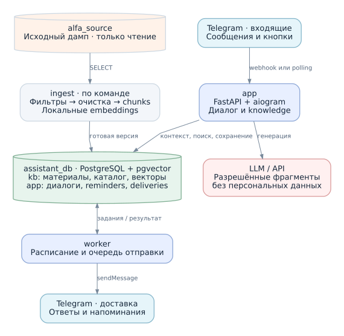
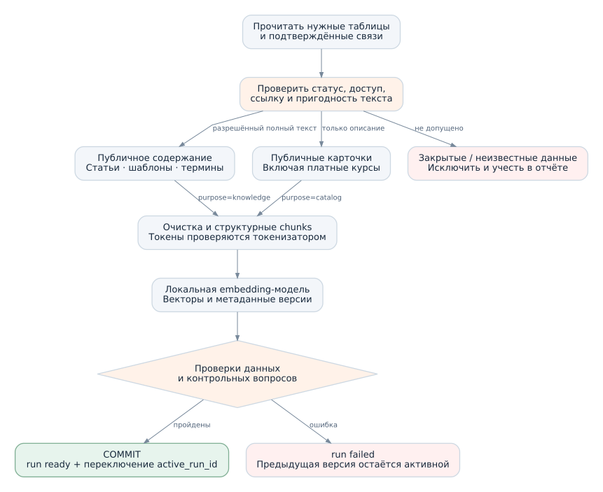
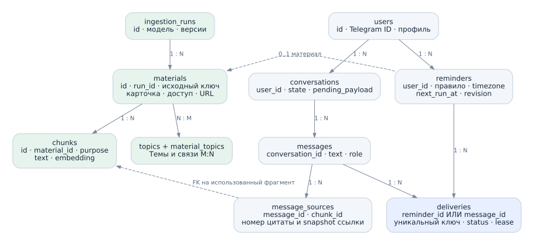
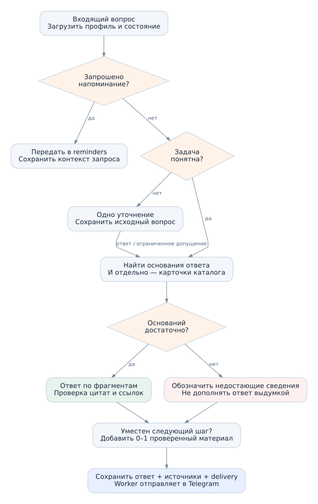
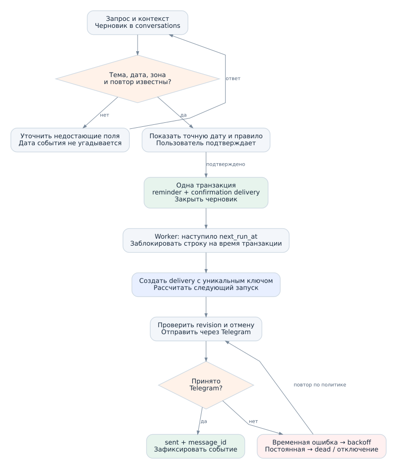

# Архитектура Telegram помощника Альфа Курс

Проектное решение для команды хакатона · Трек 2 · 11 ноября 2026

**Рекомендация:** модульный монолит на Python с тремя крупными модулями: `knowledge`, `assistant`, `reminders`. Telegram — тонкий адаптер. Одна рабочая PostgreSQL с pgvector хранит базу знаний, каталог, историю диалогов и задания на отправку. Восстановленный дамп используется отдельным процессом подготовки данных и не нужен работающему боту.

Документ нужен для общего обсуждения и параллельной разработки тремя Python-разработчиками, DevOps-инженером с Java-бэкграундом и продакт-менеджером. Это проект архитектуры и контрактов, а не готовый бот. Имена исходных полей и связей, которых нет в приложенном описании данных, требуют сверки с DDL дампа.

## 1. Что должно получиться

Пользователь приходит с бизнес-задачей. Бот помогает сформулировать её, использует известный контекст, находит разрешённые материалы, отвечает с источниками и при необходимости предлагает применимый следующий шаг. Если пользователь просит вернуться к обучению позже, бот создаёт подтверждённое напоминание и доставляет его в нужное время.

| Требование трека 2 | Как реализуем | Как показать команде и жюри |
|---|---|---|
| Ответ по базе знаний | Поиск разрешённых фрагментов → генерация → проверка ссылок | Вопрос, ответ и открываемый источник |
| Неясный вопрос | Один содержательный уточняющий вопрос за цикл консультации | «Как продвигаться?» → уточнение задачи |
| Нет ответа в базе | Сообщение о недостающих сведениях, без выдуманных фактов | Контрольный вопрос вне базы |
| Персонализация | Постепенно собираемый профиль и контекст текущего диалога | Разные ответы новичку и опытному предпринимателю |
| Бесплатные и платные материалы | Отдельный подбор по публичным карточкам каталога | Польза, тип доступа, подтверждённая ссылка |
| Разовые и повторяющиеся напоминания | once / daily / weekly, изменение, отключение | Напоминание после перезапуска процесса |
| Возврат на платформу | Уместная рекомендация и ссылка в напоминании | События показа и запроса открытия материала |

Повторения — обязательная часть MVP, а не улучшение после хакатона. Ежедневного и еженедельного интервала достаточно для первой версии; месячные правила и налоговый календарь не нужны для выполнения этого требования.

**Ограничения задания:** не публиковать дамп и его копии; не раскрывать подробности платных материалов; во внешние API передавать только необходимые разрешённые фрагменты без персональных данных и закрытого содержания; использовать предоставленные ссылки; избегать навязчивых уведомлений. Применяем эти ограничения и к JSONL, индексам, векторным представлениям, логам и внешним системам трассировки. Для демонстрации используем тестовые профили. Основание: кейс, страницы 8–11 и 14.

## 2. Почему такая архитектура

Модули вызывают друг друга обычными Python-методами через договорённые интерфейсы. Они находятся в одном репозитории, используют общий набор моделей контрактов и выпускаются одной версией. Отдельный worker нужен для фоновой работы, но не превращает систему в набор микросервисов.

| Решение | Обоснование для этой команды |
|---|---|
| Модульный монолит | Три владельца функциональности, простая интеграция, минимум сетевых зависимостей |
| PostgreSQL + pgvector | Векторы и обычные данные доступны через одну БД; транзакции для напоминаний и очереди отправки |
| Два постоянно работающих Python-процесса | `app` принимает и обрабатывает сообщения; `worker` планирует и доставляет сообщения |
| Одноразовый `ingest` | Чтение дампа и индексация не увеличивают задержку ответа пользователю |
| Предсказуемый RAG-процесс | Поиск предшествует ответу; переходы сценария контролирует код |
| Каталог внутри knowledge | Правила доступа, происхождение материалов и рекомендации имеют одного владельца |

У Qdrant есть смысл, если команда уже уверенно с ним работает или измерения покажут необходимость отдельного векторного сервиса. Тогда обычные данные всё равно останутся в PostgreSQL, а согласование индекса с каталогом станет отдельной задачей. Для этого MVP предлагается pgvector. Kafka, RabbitMQ, Redis и отдельный Java-сервис не являются необходимыми компонентами.

### Схема развёртывания

`alfa_source` и `assistant_db` — разные базы. В разработке они могут находиться в одном PostgreSQL-сервере, но пользователь чтения дампа не имеет прав записи. На демонстрационном сервере достаточно `assistant_db`: бот не получает `SOURCE_DATABASE_URL`. Дамп и файлы подготовки не кладём в Docker-образ приложения.

### Технологии и границы LangChain

| Область | Предлагаемый выбор |
|---|---|
| Telegram | aiogram; webhook через FastAPI, для локального запуска — polling через тот же слой приёма |
| Модели и контракты | Pydantic на границах, dataclass/Protocol между модулями |
| БД | PostgreSQL, pgvector, SQLAlchemy, psycopg, Alembic |
| Очистка HTML | BeautifulSoup или lxml, явные обработчики известных типов блоков |
| Разбиение | langchain-text-splitters; структурные границы + контроль токенов |
| Embeddings | Локальный baseline `intfloat/multilingual-e5-small` через sentence-transformers |
| Генерация | Выбранный командой внешний LLM/API либо локальная модель через один адаптер |
| Планирование | Небольшой Python-worker и таблицы PostgreSQL; без таймеров на каждый reminder в памяти |
| Поставка | Docker Compose, зафиксированные версии зависимостей и модели, healthchecks |

LangChain подходит как набор компонентов: документы, splitter, адаптер модели. Он не заменяет разбор вашей схемы, правила доступа, хранение состояния, проверку источников и доставку напоминаний. Для основной консультации выбираем последовательный RAG; свободное управление инструментами моделью не требуется. [1, 2]

В этом проекте таблица `kb.chunks` управляется вашей миграцией, а поиск реализуется SQL/SQLAlchemy с pgvector. Не подключайте к ней готовый `PGVector`-класс как к произвольной таблице: интеграция LangChain управляет своим форматом хранения. Это два разных варианта реализации, их не надо смешивать. [3]

Альтернативы: LlamaIndex предоставляет готовые компоненты загрузки, индексации и запросов; прямой SDK модели + sentence-transformers + SQLAlchemy даст меньше абстракций. Если команда уже начала с LangChain, менять его ради самого изменения нет необходимости. [4]

E5-small — стартовый кандидат, а не обещание лучшего качества. У него вектор из 384 чисел и предел 512 токенов; для retrieval нужны префиксы `query: ` и `passage: `. Качество русского поиска проверяем на собственных вопросах. При смене модели, её версии или размерности пересчитываем весь индекс и используем ту же модель для запросов. [5]

## 3. Три крупных модуля и владельцы

| Модуль | Владелец | Что входит | Что отдаёт другим |
|---|---|---|---|
| `knowledge` | Python 1 | Импорт, политика допуска данных, очистка, чанкинг, embeddings, поиск, каталог, рекомендации | Найденные фрагменты с происхождением; проверенные карточки материалов |
| `assistant` | Python 2 | Контекст, профиль, уточнение, выбор сценария, сбор ответа, проверка ссылок и достаточности основания | Готовый ответ или уточнение; намерение создать/изменить reminder |
| `reminders` | Python 3 | Черновик, подтверждение, дата/зона/повторение, изменение, отмена, планирование доставок | Сохранённое расписание и задания на отправку |

Python 3 также владеет тонким Telegram-адаптером: команды, кнопки, форматирование, проверка принадлежности callback пользователю, входящие обновления. DevOps берёт общий механизм outbox, приём/подтверждение webhook совместно с Python 3, процесс worker и эксплуатацию. Так нагрузка Python 3 не включает всю инфраструктуру доставки.

| Участник | Конкретный результат | Проверяемая готовность |
|---|---|---|
| Python 1 | `ingest`, схема kb, отчёт о данных, `retrieve/recommend/get_card` | Повторный запуск не создаёт дубли; закрытый текст не попадает в индекс; известные вопросы находят источники |
| Python 2 | `handle_turn`, работа с профилем, prompts, проверка цитат, обработка отсутствующего ответа | Нет бесконечного уточнения; источники принадлежат retrieval; необоснованные факты не выдаются как подтверждённые |
| Python 3 | Telegram UI, reminder service, календарные правила и команды | Разовое и повторное напоминание; изменение и отмена; чужой reminder недоступен |
| Java/DevOps | Репозиторий, Compose, PostgreSQL, миграции, общий sender/outbox, HTTPS, CI, перезапуск и диагностика | Запуск по README; worker восстанавливается; ключи отсутствуют в репозитории |
| Продакт | MVP, текст сценариев, разметка eval, политика следующего шага, метрики, демонстрация | Каждое требование трека связано с демонстрационным сценарием |

DevOps не обязан писать Python-бизнес-логику: общий sender можно сделать в паре с Python 3. Python 2 помогает с извлечением полей reminder в структурированный DTO. Любое изменение общих DTO и миграций сначала согласует их владелец; отдельный HTTP API между модулями не нужен.

## 4. Что извлекать из дампа

Описание данных сообщает о 62 таблицах и 102 128 записях, включая 855 статей, 247 документов, 351 термин и 37 курсов. Это справочная статистика из документа, а не подсчёт доступных для индексации записей. Точное количество допущенных материалов станет известно после проверки статусов и доступа.

| Исходные таблицы | Назначение | Что попадает в нашу БД | Что необходимо проверить |
|---|---|---|---|
| Articles + ArticleEmbedItems | Обоснование ответов | Публичный текст, title, источник, упорядоченные блоки | Статус, видимость, закрытость, URL, семантика Type и Order, дубли Content/HtmlContent |
| Documents + DocumentEmbedItems | Инструкции и шаблоны | Разрешённый текст, публичная карточка и предоставленная ссылка | Где текст, где ссылка на файл; есть ли закрытые части |
| Glossary + GlossaryEmbedItems | Определения терминов | Термин и определение, происхождение | Не склеивать соседние термины в один фрагмент |
| Courses + CourseTypes + Statuses | Рекомендации | Публичные название, описание, URL, тип доступа, известная цена | Точные значения справочников; Cost/TypeId сами по себе не доказывают доступ |
| ContentSettings + ContentSettingsTopics + Topics | Тематическая привязка | Нормализованные связи material ↔ topic | Реальные FK, типы сущностей и направление связи |
| RecommendedItems | Связанные материалы | Проверенные направленные связи между двумя карточками | Полиморфные типы, направление, существование и доступность обеих сторон |
| CourseSubscriptions, CourseTariffBindings, Subscription, SubscriptionTariffs | Разрешение модели оплаты | Нормализованный access_type и price_note | Связи с курсом, действительность тарифа, разовая цена или подписка |
| Lessons, LessonEmbedItems | Проверка границ платного контента | В MVP только необходимые связи/признаки для политики доступа | Полные платные уроки исключаются из контекста ответа |
| Webinars | Возможные события | Карточка и дата только после проверки полей и актуальности | Может не оказаться пригодной даты; нельзя обещать календарь заранее |
| Tags, Industries и их связки | Дополнительные признаки | Только полезные для качества признаки | Реальный прирост на eval, полнота связей |
| Пользовательские bindings и рейтинги | Возможное развитие | В MVP не нужны | Telegram-пользователя нельзя автоматически связать с обезличенным ID дампа |

**Ключевое ограничение исходных материалов:** приложенное описание не содержит полной DDL-схемы и значений справочников. Поэтому эта таблица — план извлечения, а не подтверждённая карта JOIN. Перед реализацией Python 1 выгружает PK/FK/колонки и просматривает небольшие образцы значений; продакт проверяет смысл статусов и тарифов.

В `mapping.yml` фиксируем: исходный ключ, путь к title/URL, связь блоков, порядок, разрешённые типы, условия публикации, правила оплаты, источник доказательства этих правил. Неизвестное значение даёт `unknown` и не допускает полный текст к ответу. `Cost = 0`, `NULL` или один `TypeId` не трактуем автоматически как «бесплатно».

## 5. Этап подготовки знаний и каталога

**Embedding и векторизация — один шаг:** преобразование текста в числовой вектор. После него вектор записывается в хранилище. Отдельной третьей модели для «векторизации embeddings» не требуется.

1. **Создать запуск.** Записать `kb.ingestion_runs`: fingerprint дампа, версии mapping/политики/чанкинга, модель embeddings и её revision. Статус `building`.
2. **Прочитать только нужные таблицы.** Источник — `alfa_source`, роль только SELECT. Не выгружать персональные и поведенческие данные без потребности.
3. **Применить правила допуска.** Отдельно определить `answer_allowed`, `recommend_allowed`, `external_allowed`. Полный закрытый контент не проходит дальше очистки/векторизации. Платной карточке можно разрешить рекомендацию, не разрешая текст уроков.
4. **Нормализовать материалы.** Сначала HTML entities, NBSP → обычный пробел, удаление script/style, сохранение заголовков, списков и смысловых границ. Блоки сортируются по подтверждённому Order; при равенстве — по стабильному ID. Не склеивать дублирующие Content и EmbedItems вслепую. Не обходить произвольные внешние ссылки из HTML.
5. **Разбить по структуре.** Статья → разделы → абзацы → ограниченные по токенам фрагменты. Термин с определением обычно остаётся целым. Инструкции и строки таблиц сохраняют контекст; неподдерживаемые блоки идут в отчёт, не в мусорный текст.
6. **Посчитать embeddings.** Начальный ориентир — 320–400 токенов полезного текста, overlap 40–60. Это параметры эксперимента. Полный вход с заголовком, prefix и special tokens проверяется токенизатором модели и не превышает 512; молчаливое обрезание запрещено. Запись батчами и повтор временных ошибок.
7. **Сохранить две группы фрагментов.** `purpose=knowledge` — допустимое основание ответа; `purpose=catalog` — короткие публичные карточки для поиска рекомендаций. Каталог не является доказательством подробного ответа.
8. **Проверить и опубликовать.** Проверить ссылки, допуск, размерность, пустой текст, контрольные вопросы. В одной транзакции перевести run в `ready` и переключить `kb.index_state.active_run_id`. Ошибка подготовки оставляет прежний индекс рабочим.

Для небольшого индекса сначала используем точный поиск pgvector. После измерения задержки можно добавить HNSW и сравнить полноту результата с точным поиском; фильтры при приближённом поиске тоже влияют на количество найденного. [6]

Идентичность версии материала задаётся `(run_id, source_table, source_id)`, чанка — `(material_id, purpose, chunk_no)`. Повтор того же запуска делает upsert. Новая версия строится отдельно; старые строки сохраняются, пока на них ссылается история. Все запросы одного ответа используют один зафиксированный `run_id`. JSONL при необходимости — приватный промежуточный формат для воспроизводимости, а не отдельная рабочая БД.

## 6. Рабочая база данных

| Хранилище | Содержимое | Когда пишется | Кто читает |
|---|---|---|---|
| `alfa_source` | Восстановленный исходный дамп | Один раз при восстановлении; дальше только чтение | Только `ingest` |
| `assistant_db.kb` | Версии разрешённых материалов, чанки, embeddings, темы, связи и публичные карточки | При подготовке или переиндексации | knowledge, assistant через интерфейс knowledge |
| `assistant_db.app` | Профили, диалоги, сообщения, ссылки ответа, reminders, очередь доставки и события | Во время общения и работы worker | Только владельцы соответствующих репозиториев |
| Приватные файлы подготовки | Опциональный JSONL, отчёт об исключениях, конфигурация, модель embeddings | При подготовке | Разработчики и ingest |

Схемы `kb` и `app` — пространства имён внутри одной БД. Разные схемы не означают разные серверы. Физически pgvector хранит векторы рядом с обычными колонками PostgreSQL; отдельной «векторной базы» в этом варианте нет.

### Таблицы знаний и каталога

| Таблица | Основные поля | Зачем нужна |
|---|---|---|
| `kb.ingestion_runs` | id, status, source_fingerprint, embedding_model/revision/dim, pipeline_version, metrics | Воспроизводимость и диагностика индекса |
| `kb.index_state` | singleton, active_run_id | Указатель на опубликованную версию |
| `kb.materials` | id, run_id, source_table, source_id, kind, title, summary, url, access_type, price, currency, flags, provenance | Единый каталог статьи, шаблона, термина, курса, вебинара |
| `kb.chunks` | id, material_id, run_id, purpose, chunk_no, text, section_path, source_blocks, token_count, embedding vector(384), search_tsv | Текстовый и векторный поиск с происхождением |
| `kb.topics` | id, run_id, source_id, title | Нормализованные темы текущей версии |
| `kb.material_topics` | run_id, material_id, topic_id | M:N между материалами и темами |
| `kb.material_relations` | run_id, from_material_id, to_material_id, relation_type | Проверенные связи RecommendedItems |

`kb.materials` — ваша проекция каталога, а не изменение исходной `Courses`. Для курса хранится разрешённое краткое описание. Цена nullable: отсутствие цены не равно нулю. Данные относятся к snapshot дампа; текущую цену покупки без онлайн-интеграции подтвердить нельзя.

### Операционные таблицы

| Таблица | Основные поля | Владелец и момент записи |
|---|---|---|
| `app.users` | id, telegram_user_id, telegram_chat_id, timezone, profile jsonb | assistant: первый контакт и явные сведения пользователя |
| `app.conversations` | id, user_id, state, pending_payload, clarification_count, version | assistant: переход состояния и черновик уточнения/reminder |
| `app.telegram_updates` | update_id PK, user_id, chat_id, payload, status, attempts, lease | Telegram-адаптер: до подтверждения приёма обновления |
| `app.messages` | id, conversation_id, origin_update_id, role, text, outcome, metadata | assistant: входящее сообщение и подготовленный ответ |
| `app.message_sources` | message_id, ordinal, chunk_id, title_snapshot, url_snapshot | assistant: какие источники подтверждали конкретный ответ |
| `app.reminders` | id, user_id, text, timezone, local_start, repeat_kind, interval_n, next_run_at, status, revision, confirmation_key | reminders: после подтверждения и при изменениях |
| `app.deliveries` | id, dedupe_key, kind, target_chat_id, text, reminder_id/message_id, occurrence_at, status, available_at, lease, attempts | Общая доставка: до отправки; worker обновляет результат |
| `app.events` | id, user_id, conversation_id, message_id, material_id, event_type, occurred_at, metadata | В точках бизнес-событий, без сырого диалога в metadata |

Таблиц больше, чем модулей: это данные и технические гарантии, а не отдельные сервисы. `deliveries` — outbox, то есть сохранённые задания на отправку. Она общая для ответа и reminder, чтобы не создавать два разных механизма повторов.

### Связи основных сущностей

На схеме показаны основные связи; служебные `index_state`, `telegram_updates` и `events` описаны в таблицах. Полный проект DDL с PK, FK, CHECK и индексами находится в `schema.sql`. Он создаёт только ваши таблицы в `assistant_db`; исходный дамп не затрагивается.

**Политика памяти:** в векторный индекс не записываются пользовательские сообщения, профиль и напоминания. История находится в обычных таблицах PostgreSQL. В LLM передаётся ограниченное окно очищенного диалога и только нужные поля профиля; Telegram ID, телефон, имя и другие лишние данные туда не входят. Длинную историю можно сокращать, но подтверждённые поля профиля хранятся явно, а не только в сгенерированном summary.

## 7. Процесс консультации

| Шаг | Действие | Чтение | Запись |
|---|---|---|---|
| 1 | Принять обновление, проверить дубликат | update_id | telegram_updates; users при первом контакте |
| 2 | Загрузить состояние и сохранить вопрос | users, conversations, последние messages | messages с role=user |
| 3 | Определить сценарий | Текст, pending_payload, профиль | state, подтверждённые изменения profile |
| 4 | При необходимости уточнить | Исходный вопрос и известные факты | clarification_count, исходный запрос в pending_payload, ответ + delivery |
| 5 | Сформировать самостоятельный поисковый запрос | Исходный вопрос + уточнение | Номер версии индекса в metadata ответа |
| 6 | Найти основания и карточки | kb.chunks/materials/topics/relations одного run_id | Только диагностические идентификаторы и метрики |
| 7 | Составить и проверить ответ | Допущенные фрагменты и каталог | messages, message_sources, events и delivery в одной транзакции |
| 8 | Доставить | deliveries | sent, Telegram message_id либо retry/dead |

Уточнение не задаётся просто ради полного заполнения профиля. Например, для «Как привлечь клиентов?» полезно спросить о канале продаж или текущей задаче; не нужно требовать сразу отрасль, стадию, бюджет и опыт. Если после одного уточнения запрос всё ещё широк, бот предлагает варианты задачи или даёт ограниченный общий ответ по найденным материалам, явно обозначив допущение. Дополнительные уточнения даты reminder не ограничиваются этим правилом консультации.

**Поиск:** минимальный baseline — top-k по вектору с фильтром активной версии и `purpose=knowledge`. Далее, если проверка выявит пропуски точных терминов, добавить полнотекстовый PostgreSQL-поиск и объединение рангов RRF; это не обязательно отдельный сервис. Стартовые кандидаты: top-20, затем 4–6 неповторяющихся полезных фрагментов от нескольких источников. Числа подбираются на eval. При малом каталоге можно ранжировать все 37 карточек курсов правилами и similarity.

Cosine similarity — не вероятность правильного ответа. Не фиксируем универсальное «0.8 = можно отвечать». На размеченных вопросах оцениваем релевантность, покрытие вопроса, отсутствие конфликтов и корректность источников. Сначала ограничения доступа применяет код, затем проверяется полезность содержания.

**Генерация:** модель получает инструкцию отвечать по переданным знаниям, найденные фрагменты с локальными номерами и обезличенный контекст. Материалы считаются данными, а инструкции внутри них не исполняются. Модель не получает доступ к произвольному SQL, сетевым инструментам или прямому созданию reminder.

**Проверка ответа:** каждый номер источника существует в retrieval; URL берётся из каталога, не из текста модели; карточка активна; подробности платного курса не раскрываются. Проверка существования citation не доказывает истинность фразы: соответствие утверждений источнику проверяется на eval и, при необходимости, дополнительной проверкой содержания. Если проверка провалена, выдаётся ограниченный ответ или честный отказ.

**Следующий шаг:** сначала полезность задачи, затем стадия/опыт/ограничение «только бесплатно», затем темы и RecommendedItems. Связь из RecommendedItems — сигнал, а не обязательное назначение. Предлагаем обычно один материал; при явном сравнении — до двух. Формат: «Почему поможет → доступ/известная цена → предоставленная ссылка». Если подходящего материала нет, ответ заканчивается без рекомендации.

Отсутствие основания для ответа не запрещает рекомендацию курса: бот может сказать, что подробного ответа в открытой базе нет, и отдельно показать подходящую публичную карточку. Нельзя пересказывать маркетинговое описание как найденное решение вопроса.

## 8. Процесс напоминания

Напоминание — обычная бизнес-функция с транзакцией, календарём и фоновой доставкой. RAG нужен здесь только для разрешения ссылки на материал или поиска сведений о событии. Планировщик работает без вызовов LLM.

| Ситуация | Поведение |
|---|---|
| «Напомни завтра в 19:00 отправить документы» | Извлечь задачу, определить локальную дату, уточнить неизвестный часовой пояс, показать подтверждение |
| «Напомни про этот курс» | Разрешить материал из последней рекомендации; если вариантов несколько — предложить выбор; спросить время |
| «Напомни» | Запросить недостающие тему и время |
| «Напомни перед событием» | Уточнить событие; искать точную дату только в пригодных подтверждённых данных; иначе попросить дату у пользователя |
| «Каждую неделю по вторникам в 19:00» | Первый вторник, локальная зона, repeat=weekly; показать первую отправку и правило |
| «Поменяй частоту» / «Отключи» | Проверить владельца, изменить/отменить расписание и неотправленные задания старой revision |

Для налоговой даты недостаточно упоминания дня и месяца в старой статье. Нужны применимость режима, отчётный период/год и подтверждённая актуальность. Если этих данных нет, бот сообщает ограничение и просит пользователя указать дату. Внешних государственных интеграций MVP не требует. Дата, введённая пользователем, сохраняется как `date_origin=user`, а не как подтверждённый юридический срок.

### Состояние и время

Черновик хранится в `conversations.pending_payload`: text, material source key, local datetime, IANA timezone, recurrence, недостающие поля, draft_id и версия. До подтверждения строки активного reminder нет. Карточка подтверждения показывает **абсолютную дату, время, часовой пояс, текст, ссылку и повторение**. Для неясного времени или даты в прошлом сохранение запрещено.

Например, если пользователь в `Europe/Moscow` пишет 11 ноября 2026 года «завтра в 19:00», preview показывает 12 ноября 2026, 19:00 МСК. `next_run_at` хранится как `2026-11-12T16:00:00Z`; локальное правило и зона сохраняются отдельно. Это иллюстрация обработки времени, не созданное напоминание.

После подтверждения одной транзакцией создаются `reminders` и ответ-подтверждение в `messages/deliveries`; черновик закрывается. Уникальный `confirmation_key` строится из user_id и draft_id, а не из update_id: два нажатия создают разные Telegram updates, но подтверждают один черновик. При двух подтверждениях одного draft возвращается существующий reminder. Callback проверяет пользователя и версию draft.

Для повторов сохраняются `local_start`, `timezone`, `repeat_kind`, `interval_n`, `next_run_at`. Следующее наступление считается по локальному календарю, а не прибавлением 24 часов к UTC. Для перехода летнего времени заранее фиксируем правило: отсутствующее локальное время переносится на ближайшее допустимое; неоднозначное — первое вхождение. Показываем реально рассчитанное следующее время. Это правило приложения, не требование кейса.

### Что делает worker

1. Каждые 5–10 секунд выбирает наступившие reminders короткой транзакцией с `FOR UPDATE SKIP LOCKED`.
2. В этой же транзакции создаёт delivery с уникальным `(reminder_id, revision, occurrence_at)` и передвигает `next_run_at` либо завершает разовое расписание. Статус `completed` означает «задание создано»; фактическая отправка проверяется по delivery.
3. Claim-ит готовые delivery: ставит `leased`, `lock_token`, `locked_until`, увеличивает attempts и коммитит. Сетевого вызова внутри удерживаемой SQL-транзакции нет.
4. Перед отправкой reminder ещё раз проверяет статус, revision, принадлежность и доступность ссылки в активном каталоге по исходному ключу материала. Недоступную/снятую карточку не отправляет как действующую рекомендацию; сообщает изменение доступности.
5. Отправляет сообщение через Telegram и сохраняет `telegram_message_id`, `sent_at`, статус `sent`. При временной ошибке планирует повтор с backoff; при 429 учитывает `retry_after`; при блокировке бота пользователем отключает дальнейшие отправки ему. [7, 8]
6. После сбоя возвращает просроченные lease в обработку. Обновление результата выполняет только владелец актуального `lock_token`.

При отмене/изменении увеличивается `revision`, pending-delivery старой версии отменяются, leased-delivery проходят повторную проверку. Уже начатый запрос к Telegram отозвать нельзя: отмена действует на ещё не начатые отправки. Технические дубли заданий предотвращаются уникальными ключами, но end-to-end exactly-once обещать нельзя: Telegram мог принять сообщение, а процесс — упасть до записи `sent`. При повторе возможен дубль; это известный крайний случай и для ответов, и для reminders.

После длительного простоя не отправляем пачку пропущенных повторов. Предлагаем правило MVP: максимум одно пропущенное событие, если оно не старше 24 часов; остальное отмечается как пропущенное, следующее время пересчитывается в будущее. Для разового reminder старше этого окна фиксируется пропуск. Порог и поведение показываются в описании бота и проверяются продактом.

## 9. Надёжность входящих сообщений

Основной режим развёртывания — webhook: проверить секрет Telegram → нормализовать нужные поля → `INSERT telegram_updates ON CONFLICT DO NOTHING` → COMMIT → ответить HTTP 200. Дубликат подтверждается без повторного создания вопроса. Если БД недоступна, успешный ответ не возвращается. Telegram поддерживает секрет webhook и повторяет неуспешные доставки ограниченное число раз. [7]

Отдельная async-задача внутри процесса app забирает принятые обновления. В MVP работает одна реплика app, но сообщения одного чата обрабатываются последовательно; разные чаты могут обрабатываться конкурентно с лимитом вызовов LLM. Статусы и lease находятся в БД, а не только в памяти. После рестарта зависшие обновления возобновляются. Частичный уникальный индекс допускает не более одного processing-update на chat_id.

В локальном polling-режиме тот же inbox записывается **до** продвижения offset в getUpdates; стандартный in-memory dispatch не считается гарантией сохранности. Одновременно polling и webhook не включаются. Обработка сообщения идемпотентна по update_id; сохранённый assistant-ответ повторно не генерируется, а доставляется через существующий outbox.

## 10. Структура репозитория

| Путь | Содержимое и владелец |
|---|---|
| `src/alfa_bot/entrypoints/api.py` | FastAPI, webhook, health/readiness — Python 3 + DevOps |
| `src/alfa_bot/entrypoints/polling.py` | Локальный приём Telegram в тот же inbox — Python 3 |
| `src/alfa_bot/entrypoints/worker.py` | Планировщик reminders + sender — Python 3 + DevOps |
| `src/alfa_bot/entrypoints/ingest.py` | Запуск подготовки — Python 1 |
| `src/alfa_bot/contracts.py` | Общие DTO, Protocol и ошибки; изменения согласуются командой |
| `src/alfa_bot/knowledge/` | service.py, ingestion.py, parsing.py, access.py, repository.py, mapping.yml — Python 1 |
| `src/alfa_bot/assistant/` | service.py, context.py, prompts.py, validation.py, repository.py — Python 2 |
| `src/alfa_bot/reminders/` | service.py, schedule.py, repository.py — Python 3 |
| `src/alfa_bot/adapters/telegram.py` | Команды, кнопки и рендеринг ответа — Python 3 |
| `src/alfa_bot/infra/` | config.py, db.py, llm.py, embeddings.py, inbox.py, outbox.py, logging.py — владельцы согласуют |
| `migrations/` | Alembic; одна линейная последовательность миграций — DevOps координирует |
| `tests/` | Проверки политики доступа, состояний и конкурентных изменений |
| `eval/` | Размеченные вопросы, ожидаемые источники и отчёт качества — Python 2 + продакт |
| `docs/` | Архитектура, сценарий проверки, известные ограничения |
| `private_data/` | Локальные входные данные; исключены из git и Docker build context |
| Корень | README.md, pyproject.toml + lock, Dockerfile, compose.yaml, env.example, .gitignore, .dockerignore |

Это крупные пакеты, внутри которых достаточно service/repository и нескольких файлов по назначению. Отдельные сервисы для chunking, embeddings, citations, profile или recommendation не требуются.

### Общие контракты до реализации

| Контракт | Вход | Выход | Важное правило |
|---|---|---|---|
| `Knowledge.retrieve` | query, limit, optional run_id | run_id и список Evidence | Возвращает только допустимые основания; пустой список — штатный исход |
| `Knowledge.recommend` | query, профиль, run_id, исключённые материалы | Карточки с объясняющими признаками | Цена и URL из каталога, не из LLM |
| `Knowledge.get_card` | source_table, source_id, run_id | Карточка либо None | Позволяет разрешить материал после переиндексации |
| `Assistant.handle_turn` | user_id, conversation_id, update_id, text | Сохранённый результат обработки | Повтор update_id не создаёт новый ответ |
| `Reminders.prepare` | намерение + локальный контекст | Draft с missing_fields | Не создаёт активное расписание |
| `Reminders.confirm` | user_id, draft_id/version, confirmation_key | ReminderView | Транзакция, проверка владельца и идемпотентность |
| `Reminders.change/cancel` | user_id, reminder_id, expected_revision | Обновлённый ReminderView | Нельзя изменить чужой объект или потерять параллельное изменение |

В `contracts.py` приложены начальные Python-интерфейсы без зависимости от LangChain и ORM. Каждый разработчик может начать с fake-реализации соседа. Имена таблиц и SDK-классы не протекают через эти интерфейсы. Типовые ошибки: ValidationError, NotFound, Conflict, DependencyUnavailable; отсутствие релевантного материала — не исключение.

## 11. План работ и зависимости

Срок хакатона в сообщении не указан, поэтому ниже контрольные этапы, а не выдуманный календарь. Их можно разложить на ваш оставшийся срок. Сначала собираем сквозной работающий путь, затем расширяем покрытие данных и качество.

| Этап | Python 1 | Python 2 | Python 3 | DevOps | Продакт |
|---|---|---|---|---|---|
| 0. Общий договор | Карта источников и правил доступа | DTO ответа, состояния диалога | DTO reminders, кнопки | Репозиторий, миграции, окружение | MVP и тестовые диалоги |
| 1. Сквозной путь | 10–20 проверенных материалов + retrieve | Один ответ с источником | Telegram input/output + разовый reminder | Compose, БД, inbox/outbox | Проверка первого сценария |
| 2. Обязательная функциональность | Полный разрешённый корпус, каталог, связи | Уточнение, no-answer, профиль, рекомендации | daily/weekly, изменение, отмена, timezone | Стабильный worker и рестарт | Разметка eval, тексты ошибок |
| 3. Интеграция | Дубли и доступ; tuning поиска по ошибкам | Проверка цитат, timeouts, качество | Параллельные callback, отмена при доставке | HTTPS, health, секреты, запуск с чистого окружения | Приёмка всех требований |
| 4. Заморозка | Версия индекса и отчёт | Финальный eval | Demo script | Доступный бот и воспроизводимый запуск | Презентация и защита |

**Критическая зависимость:** mapping и контракты → первый маленький индекс → настоящий ответ в Telegram → каталожная рекомендация → обязательные reminder-сценарии. До готовности индекса Python 2 использует fake Knowledge, Python 3 — fake Assistant. Ни один разработчик не должен ждать завершения всего парсера.

Модульные критерии завершения не заменяют общую приёмку: каждую интеграцию проверяем в Telegram с реальной БД и перезапуском worker. Ежедневно или на каждом крупном этапе собираем короткую общую демонстрацию, а не только показываем отдельные функции в ноутбуках.

## 12. Проверка качества и бизнес-эффекта

| Проверка | Ожидаемый результат |
|---|---|
| Вопрос с известным ответом | Полезный ответ, правильные источники и применимый следующий шаг |
| Неоднозначный вопрос | Уточнение; после ответа не теряется исходный вопрос |
| Вопрос вне базы | Нет выдуманного содержания и выдуманного URL |
| Запрос подробного платного урока | Только разрешённая карточка и предложение перейти на платформу |
| Новый и известный пользователь | Холодный старт без анкеты; позже учитываются явно известные сведения |
| «Только бесплатно» | Исключены paid/subscription/unknown; отсутствие подходящего результата допустимо |
| Повтор ingest | Нет дублей внутри run; незавершённый run не становится активным |
| Разовое и повторное напоминание | Верное время и зона; повтор вычисляется по правилу |
| Перезапуск между сохранением и отправкой | Задание сохраняется и обрабатывается после восстановления |
| Двойной callback / повтор update | Один reminder / одно задание обработки |
| Изменение и отмена | Новая revision; старые ожидающие отправки не доставляются |
| Сбой LLM или Telegram | Понятное сообщение/повтор по политике; нет зависшего бесконечного состояния |
| Prompt injection в материале | Инструкция из корпуса не меняет сценарий и не раскрывает данные |

Продакт и Python 2 размечают ориентировочно 30–50 вопросов: найденный ответ, уточнение, отсутствие ответа, рекомендации платного/бесплатного, политика доступа. Для каждого нужны ожидаемое поведение и допустимые источники. Часть вопросов оставляем контрольными и не используем при подборе порогов.

Измеряем Recall@k по источникам, обоснованность ответа, правильность citation, уместность рекомендаций, долю верных отказов, задержку p50/p95, число и стоимость вызовов модели. Защитные проверки: ноль раскрытых закрытых текстов и выдуманных URL в контрольном наборе. Числовые цели качества и задержки команда утверждает после первого измерения; это не уже полученные результаты.

Для бизнеса пишем события `answer_delivered`, `recommendation_shown`, `material_open_requested`, `reminder_confirmed`, `reminder_sent`, `reminder_cancelled`, `feedback`. Показ — после успешной доставки карточки. Запрос открытия — callback перед выдачей исходной URL; обычная URL-кнопка сама не сообщает боту о клике. Такой callback показывает намерение, но не доказывает посещение или покупку.

После внедрения предлагается A/B-сравнение консультации с уместным следующим шагом и консультации без такого блока; напоминания тестируются только среди согласившихся пользователей. Основные показатели — реальный переход/возврат на платформу и конверсия в покупку, если есть платформенные события; защитные — отключения уведомлений, жалобы и негативная оценка. В хакатонном прототипе не заявляем рост конверсии по синтетическим событиям.

## 13. Что показать команде за 10 минут

1. **Одна минута:** пользователь, проблема и ожидаемый результат трека 2.
2. **Две минуты:** схема развёртывания, границы трёх модулей, отдельный offline-ingest.
3. **Две минуты:** процесс вопроса — уточнение, найденное основание, ответ, следующий шаг.
4. **Две минуты:** процесс reminder — подтверждение, транзакция, очередь, повтор, отмена.
5. **Две минуты:** владельцы, контракты и первый общий checkpoint.
6. **Одна минута:** ограничения, что проверить по дампу, критерии готовности.

На этой встрече фиксируем модель embeddings/генерации, правило платного доступа, список периодов reminders, владельца каждого интерфейса и момент первой интеграции. Выбор генератора остаётся конфигурацией: название сервиса, модель, лимиты и способ подключения ключа обязательно попадают в итоговый README.

По условиям сдачи потребуется PDF-презентация и исходный код с инструкцией запуска; допустим ZIP с кодом, документацией и PDF. На первом слайде — порядок проверки и ссылка на репозиторий, если сдаёте через него. Текущий пакет — архитектурная основа для команды, он не заменяет конечный работающий прототип и презентацию.

## 14. Источники и границы уверенности

Исходные материалы команды: «Альфа-Банк_кейс-2(3).pdf», страницы 8–14; «Описание данных(3).docx»; две предоставленные схемы процессов. Дамп, его DDL и содержимое таблиц в этой работе не были предоставлены. Реальные JOIN, значения справочников, наличие даты в Webinars и адреса материалов не выдумывались.

Технические первоисточники, проверенные 11 ноября 2026 года:

1. [LangChain — Retrieval и варианты RAG](https://docs.langchain.com/oss/python/langchain/retrieval).
2. [LangChain — Recursive text splitter](https://docs.langchain.com/oss/python/integrations/splitters/recursive_text_splitter).
3. [LangChain — PGVector integration](https://docs.langchain.com/oss/python/integrations/vectorstores/pgvector).
4. [LlamaIndex — Building an LLM application](https://developers.llamaindex.ai/python/framework/understanding/).
5. [Model card — intfloat/multilingual-e5-small](https://huggingface.co/intfloat/multilingual-e5-small).
6. [pgvector — официальный репозиторий и руководство](https://github.com/pgvector/pgvector).
7. [Telegram Bot API — webhooks и sendMessage](https://core.telegram.org/bots/api).
8. [PostgreSQL — SELECT и SKIP LOCKED](https://www.postgresql.org/docs/current/sql-select.html).

Технические схемы, структура модулей, числовые стартовые параметры поиска и политика восстановления — предложения для вашей команды. Качество поиска, задержки, доступность внешней модели и корректность исходного mapping необходимо подтвердить на вашем окружении и данных.
